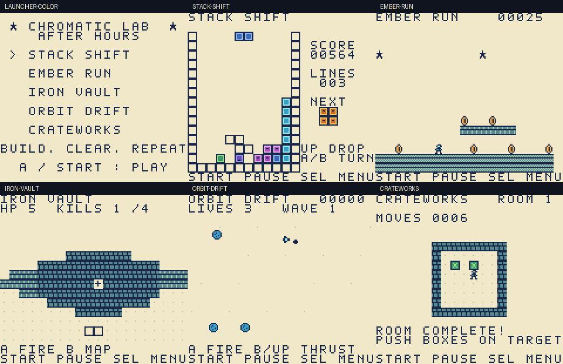

# Chromatic Lab: After Hours

Five original, playable mini-games in one native **32 KB Game Boy / Game Boy Color ROM**, built for a later handoff to ModRetro Chromatic. All graphics are original 8×8 pixel art. No commercial game code, ROMs, assets, or BIOS files are included.

| Game | Play | Controls |
| --- | --- | --- |
| **Stack Shift** | Stack seven-piece bags, clear rows, and chase a score in a 10×14 well. Ghost landing preview, next piece, kicks and faster gravity. | Left/right move; A clockwise; B counterclockwise; down soft drop; up hard drop. |
| **Ember Run** | A scrolling platform course with coins, gaps, an enemy to stomp and a gate at the far end. Hold A for a higher jump. | Left/right move; A jump. |
| **Iron Vault** | A compact first-person raycast dungeon with a tactical map. Destroy four sentinels, then reach cell 6,6 to escape. Five health points. | Left/right turn; up/down move; A fire; B toggle map. |
| **Orbit Drift** | An asteroid arena with momentum, screen wrapping, three lives and four escalating waves. | Left/right rotate; up or B thrust; down brake; A shoot. |
| **Crateworks** | Three authored box-pushing puzzles. Push every crate onto a target to advance. | D-pad move/push; B undo the last move; A reset the room. |

**Every game:** Start pauses/resumes; Select returns to the launcher. On the result screen, A retries and B returns to the launcher. Progress lives in working RAM; this version has no persistent save system. These are original genre interpretations, including a small raycast shooter, rather than ports of Tetris, Mario or Doom.

## Build in this cloud environment

```sh
cd /workspace/chromatic_lab
source /workspace/.chromatic-tools/activate.sh
make
make test
```

GBDK **4.5.0**, Python **3.12**, and PyBoy **2.7.0** are prepared outside the checkout. The cloud install script is saved in environment settings with the official GBDK artifact SHA-256 and hash-locked Python wheels. No API keys, application services, or USB access are needed for cloud development.

`make` produces `build/chromatic-arcade.gbc` plus its linker map and symbols. `make test` boots the **actual compiled ROM**, sends controller inputs, and verifies launcher/pause/return behavior in color and monochrome modes, stacking and line clears, platform physics and death, shooter hit/damage, asteroid movement and firing, and completion of all three crate rooms. It does not write emulator memory to manufacture outcomes. Framebuffers and a report tied to the ROM digest go into `build/playtest/`.

`make release` runs those checks and packages the verified ROM into `roms/`, copies the emulator preview and validation report into `docs/`, and creates `build/chromatic-lab-source.zip` for handoff.

## Take it to your Mac and Chromatic

The portable artifacts are [the native ROM](roms/chromatic-arcade.gbc), [its checksum](roms/SHA256SUMS), and this source repository. See [the local Mac handoff](docs/chromatic-handoff.md) for the plugin workflow and the distinction between live host streaming and cartridge flashing.

The cloud machine cannot see a Chromatic attached to your Mac. Emulation verifies software behavior and the ROM format; it does not verify physical controls, audio, USB transport, cartridge compatibility, or hardware performance.

For a local source rebuild, use the installed plugin's dependency setup to locate GBDK, then pass that installation to this Makefile:

```sh
make GBDK_HOME=/absolute/path/to/gbdk
```

The source is a GBDK C project, rather than a GB Studio visual-editor project. The local plugin can inspect and deploy the built ROM within an authorized checkout. To run this repository's Python tests locally, use Python 3.12 in an isolated virtual environment and install `requirements-dev.txt` through pip with normal TLS verification.

## Hardware format

- 160×144 display, 8×8 tiles, native joypad controls and integer-only gameplay.
- Color-compatible header (`0x80`), with a monochrome fallback and CGB double-speed support.
- ROM-only cartridge type (`0x00`), 32 KB ROM, zero cartridge RAM; no mapper or external assets needed.
- 96 font tiles, 20 background art tiles and 11 sprite tiles; within Game Boy limits.
- Checksummed release; [validation evidence](docs/validation.json) describes the tested file exactly. Physical testing remains pending.


